<!-- Header -->
<p align="center">
  
</p>

<p align="center">
  <a href="https://github.com/jo-jordan">
    
  </a>
</p>

<p align="center">
  
  <a href="https://github.com/jo-jordan?tab=followers"></a>
  
  
</p>

## `~/about`

```gdscript
extends Developer
class_name YidanMao

var based_in  := "Tokyo 🗼"
var building  := ["Two Godot games for Steam"]
var learning  := ["Godot Engine", "Game networking"]
var backend   := ["Go", "Kotlin", "C#", "Java"]
var off_hours := "Rock 'n' roll 🎸"

func _ready() -> void:
	print("Drinking or coding.")  # the bio, compiled
```

## `~/stack`

<p align="center">
  
</p>

## `~/featured`

<p align="center">
  <a href="https://github.com/jo-jordan/Holdem"></a>
  <a href="https://github.com/jo-jordan/go-holdem"></a>
  <a href="https://github.com/jo-jordan/super-holdem-server"></a>
  <a href="https://github.com/jo-jordan/websocket_server"></a>
</p>

## `~/stats`

<p align="center">
  
  
</p>

<p align="center">
  
</p>

<p align="center">
  
</p>

<p align="center">
  <picture>
    <source media="(prefers-color-scheme: dark)" srcset="https://raw.githubusercontent.com/jo-jordan/jo-jordan/output/github-snake-dark.svg" />
    
  </picture>
</p>

<!-- Footer -->
<p align="center">
  
</p>

<p align="center"><sub>Profiles that ship games ship them in Godot. 乾杯 🍶</sub></p>
